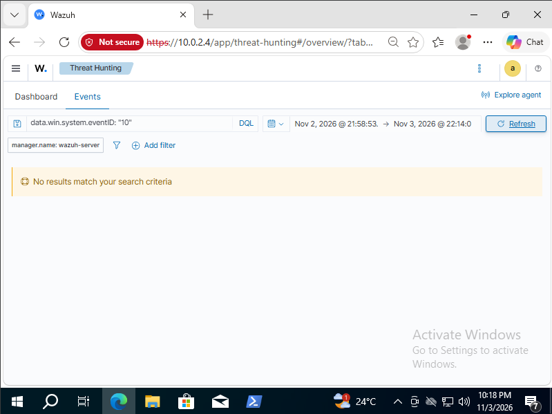
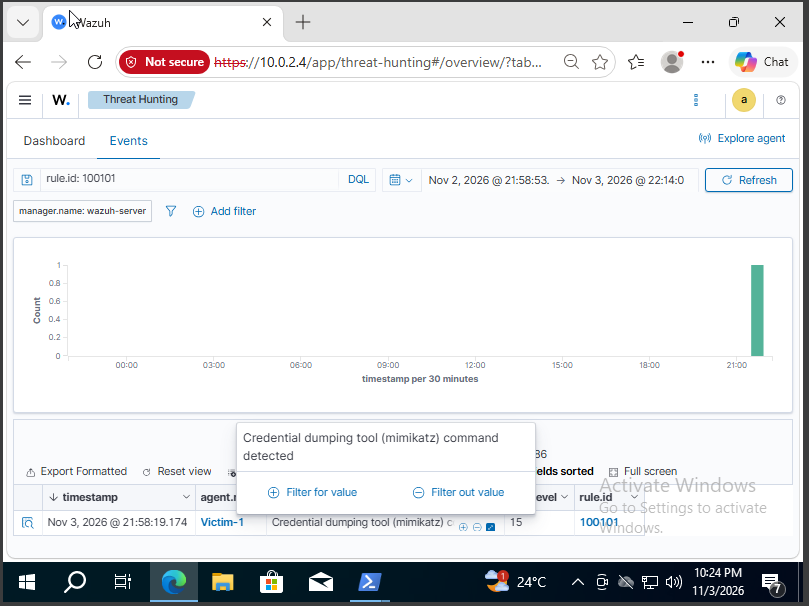

# Purple-Team Home Lab: Attack, Detect, Remediate

I built a small lab, ran a full intrusion against it, then switched to the
blue-team side and detected my own attack. This repo is everything I did and
what I took away from it.

**The short version:** I stood up 3 VMs (Kali, Windows 10, and a Wazuh SIEM) and
ran a complete attack chain, from reconnaissance all the way through to
credential dumping, then measured how much of it my monitoring actually picked
up. It flagged the noisy techniques but missed credential dumping entirely, which
is one of the most damaging steps in the chain. So I wrote my own detection rule
to close that gap. Coverage went from **4 to 5 of 10** techniques, and credential
dumping went from generating no alert to firing a **high-severity detection**.

It's a purple-team project because I ran both sides: the offensive (red) attack
chain and the defensive (blue) detection engineering.

---

## Lab architecture

```
   VirtualBox NAT network (10.0.2.0/24), fully isolated, no internet

   Kali Linux  ──attacks──>  Windows 10 Pro  ──Sysmon/agent──>  Wazuh SIEM
   10.0.2.3                  10.0.2.15                           10.0.2.4
   (attacker)               DESKTOP-RVJTQU1                     (Ubuntu OVA)
                            Sysmon + Wazuh agent
```

More detail in [`lab-setup/`](lab-setup/).

---

## The main result: 4 -> 5 of 10

Out of the box, Wazuh + Sysmon detected the noisy stages of the attack but was
blind to **credential dumping (T1003.001)**. That was the gap I set out to close,
so I wrote a custom Wazuh rule for it.

| Technique | ATT&CK | Default | After my rule |
|-----------|--------|:-------:|:-------------:|
| Network service discovery | T1046 | No | No |
| Brute force (RDP) | T1110.001 | **Yes** | **Yes** |
| Valid accounts / RDP login | T1078 / T1021.001 | Partial | Partial |
| Ingress tool transfer (certutil) | T1105 | **Yes** | **Yes** |
| Msiexec privesc (AlwaysInstallElevated) | T1218.007 / T1548.002 | Partial | Partial |
| Impair defenses (disable Defender) | T1562.001 | No | No |
| Create backdoor admin account | T1136.001 | **Yes** | **Yes** |
| Scheduled-task persistence | T1053.005 | No (gap) | No (gap) |
| **OS credential dumping (LSASS)** | **T1003.001** | **No (gap)** | **Yes (level 15)** |
| Offline password cracking | T1110.002 | n/a (offline) | n/a |

Full breakdown with notes: [`reports/detection-coverage.md`](reports/detection-coverage.md).

### Before and after, the rule firing

| Before (no detection) | After (level-15 alert) |
|---|---|
|  |  |

---

## The write-ups

- **[Pentest report](reports/pentest-report.md)**, the full attack chain, step by
  step, with ATT&CK IDs, screenshots, and a findings table.
- **[Incident report](reports/incident-report.md)**, the same intrusion from the
  defender's side: timeline, root-cause analysis, IOCs, response, and takeaways.
- **[Detection coverage table](reports/detection-coverage.md)**, every technique
  mapped against what the SIEM detected.

## The attack chain

Reconnaissance -> RDP brute force -> initial access as a weak user -> enumeration
-> privilege escalation to SYSTEM via `AlwaysInstallElevated` -> persistence (a
backdoor admin account + a scheduled task) -> credential dumping -> offline
cracking. Full timeline: [`attack/attack-log.md`](attack/attack-log.md).

## The detection I wrote

[`detection/local_rules.xml`](detection/local_rules.xml), a Wazuh rule
(`id 100101`, level 15) that flags credential-dumping command lines. I first tried
to detect it by watching for LSASS access (Sysmon event 10,
[`detection/sysmon-lsass-processaccess.xml`](detection/sysmon-lsass-processaccess.xml)),
but that signal never fired reliably in my lab, so I pivoted to matching the
command line instead. The write-up is in
[`detection/README.md`](detection/README.md).

---

## Repo layout

```
purple-team-home-lab/
├── README.md          <- this
├── lab-setup/         <- topology + the weaknesses I planted
├── attack/            <- the full attack timeline
├── detection/         <- my Wazuh rule + the Sysmon block I tried first
├── reports/           <- pentest report, incident report, coverage table
└── screenshots/       <- 10 screenshots as evidence
```

## Tools used

**Offensive:** Nmap, NetExec, Hydra, Metasploit/msfvenom, Mimikatz, John the
Ripper, xfreerdp
**Defensive:** Wazuh, Sysmon (SwiftOnSecurity config), custom Wazuh rule
authoring, MITRE ATT&CK mapping
**Also:** a lot of reading docs, breaking the lab, and tracing down why

## What went wrong (and how I worked through it)

I'm keeping this in because troubleshooting was half the learning:

- NetExec's RDP module wouldn't authenticate, so I switched to Hydra.
- Hydra was slow and noisy, tripped Windows' default account lockout, and at one
  point **bluescreened the Windows VM**.
- Defender detected and deleted my first payload, which is exactly what it
  should do. I only disabled it afterward to isolate what the SIEM would catch on
  its own.
- The "textbook" way to detect credential dumping (LSASS access via Sysmon
  event 10) never logged in my lab, so I found a signal that actually fires.

---

## Disclaimer

This is an educational project. Everything ran on **VMs I own**, on my own
laptop, with **no connection to any real network**. The weak settings exist on
purpose, to give me a realistic target, don't replicate them on anything real.
The offensive tooling is here for learning and defensive research only.

No malware, payloads, or Mimikatz binaries are committed to this repo (see
[`.gitignore`](.gitignore)), just screenshots and write-ups.
