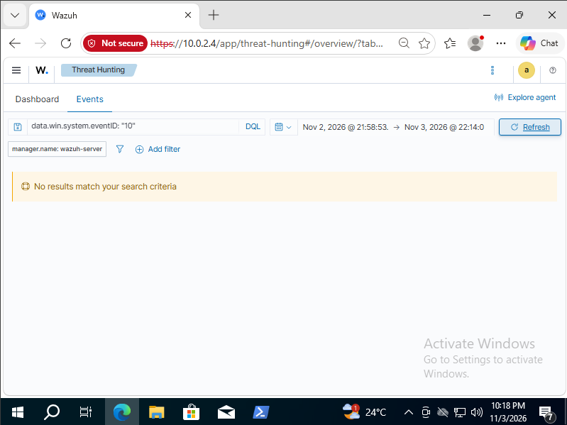
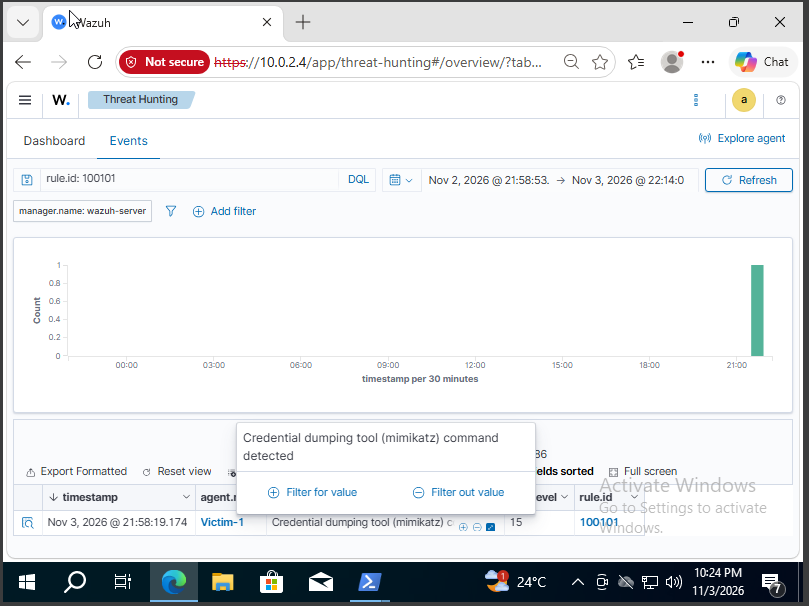

# Incident Report: Workstation Compromise (Lab Simulation)

| | |
|---|---|
| **Incident ID** | LAB-2026-11-03-01 |
| **Affected host** | `DESKTOP-RVJTQU1` (Windows 10 Pro, 10.0.2.15), Wazuh agent "Victim-1" |
| **Detected by** | Wazuh SIEM (manager `wazuh-server`, 10.0.2.4) + Sysmon |
| **Date** | 2026-11-03 (Africa/Cairo, UTC+2) |
| **Severity** | High, full host compromise (SYSTEM) + credential theft |
| **Analyst** | Mazen Ashraf |
| **Status** | Contained (lab), written as a blue-team after-action report |

> **Note:** This describes a *simulated* intrusion in an isolated personal lab.
> It is written from the defender's point of view, as if responding to a real
> incident, to demonstrate incident-handling and detection-engineering skills.

---

## 1. Summary

On 2026-11-03, the workstation `DESKTOP-RVJTQU1` was compromised via a weak
password on an exposed Remote Desktop (RDP) service. The attacker (source
`10.0.2.3`) logged in as the standard user `jsmith`, exploited a Windows
installer misconfiguration (`AlwaysInstallElevated`) to escalate to SYSTEM,
created a backdoor administrator account (`svc_backup`) and a persistence
scheduled task ("OneDrive Sync Helper"), and dumped credentials from LSASS
memory.

The SIEM detected the noisy stages of the attack: brute force, file downloads,
payload drops, and the creation of the rogue administrator, but was initially
**blind to the credential-dumping step**. A custom detection rule was engineered
in response and now alerts on that activity at high severity.

---

## 2. Timeline of Events

Times are Africa/Cairo (UTC+2). The attacker-side actions are reconstructed from
the engagement; the Wazuh alert times are the blue-team observations.

> **Time-zone note:** The Wazuh dashboard initially displayed times ~10 hours off
> (default Pacific time zone). The Windows time zone was corrected to Cairo
> (UTC+2) mid-session, so all times here are aligned to Cairo. Some screenshot
> timestamps reflect a later Phase-5 validation re-run (see 21:58 entry).

| Time | Source | Event |
|------|--------|-------|
| 16:38 | Attacker | Port scan of `10.0.2.15` -> RDP (3389) discovered |
| 16:56-17:29 | Attacker | Brute-force attempts against `jsmith` over RDP |
| ~17:29 | **SIEM** | 1,157 authentication-failure events; `jsmith` locked by default policy |
| 18:07 | Attacker | Successful RDP login as `jsmith` |
| 18:24-18:27 | Attacker | Enumeration: `whoami /groups`, `AlwaysInstallElevated = 0x1` found |
| 18:34 | **Endpoint** | Microsoft Defender detected & deleted the first MSI payload |
| 18:36 | Attacker | Defender real-time protection disabled (test scoping) |
| 18:39 | Attacker | `msiexec` MSI executed -> SYSTEM reverse shell |
| 18:40:47 | **SIEM** | Rule 92213, executable dropped in folder commonly used by malware (level 15) |
| **18:41:26** | **SIEM** | **Rule 60154, "Administrators Group Changed" (level 12)**, `svc_backup` added to admins |
| 18:44-19:11 | **SIEM** | Rule 92075, "CertUtil.exe launched with commands to download" (level 12) |
| 18:24-19:11 | **SIEM** | Rules 92207 / 92213, executable dropped in `Users\Public` / malware-common folders |
| 19:08 | Attacker | Mimikatz `sekurlsa::logonpasswords` -> NTLM hashes dumped (**no alert at the time**) |
| 19:20 | Attacker | `jsmith` hash cracked offline -> `password123` |
| **21:58:19** | **SIEM** | **Rule 100101, "Credential dumping tool (Mimikatz) command detected" (level 15)**, custom rule, fired during the Phase-5 validation re-run |

---

## 3. Root Cause Analysis

The incident resulted from a **chain of two issues**, neither advanced on its own:

1. **Primary root cause: weak credentials on an exposed service.** The account
   `jsmith` used `password123` and was reachable over RDP (3389). This gave the
   attacker interactive access to the host. A strong password and/or MFA, or not
   exposing RDP, would have stopped the intrusion at the front door.

2. **Escalation root cause: a dangerous misconfiguration.** With a foothold,
   the attacker found `AlwaysInstallElevated = 0x1` in both registry hives,
   which let a standard user install an MSI as SYSTEM. This turned limited access
   into full control.

Everything after that, the backdoor account, the persistence task, and the
credential theft, was a consequence of SYSTEM-level control.

---

## 4. Indicators of Compromise (IOCs)

| Type | Value |
|------|-------|
| Attacker IP | `10.0.2.3` |
| Ports | `4444`, `4445`, `8000` |
| Backdoor account | `svc_backup` |
| Scheduled task | `OneDrive Sync Helper` -> `C:\Users\Public\updater.exe` (onlogon, SYSTEM) |
| Malicious files | `C:\Users\Public\setup.msi`, `updater.exe`, `m.exe` |
| Command-line IOCs | `certutil -urlcache -split -f http://...`; `sekurlsa` / `privilege::debug` in a process command line |
| `jsmith` NTLM | `a9fdfa038c4b75ebc76dc855dd74f0da` |
| `Virtual` NTLM | `1f7da2c18a55ffe8d00e79a4fde2bbd8` |

---

## 5. Response & Remediation

### Immediate containment
1. **Isolate the host** from the network to stop any active attacker session and
   persistence callbacks.
2. **Delete the backdoor account** `svc_backup` (`net user svc_backup /delete`).
3. **Remove the persistence task** `OneDrive Sync Helper`
   (`schtasks /delete /tn "OneDrive Sync Helper" /f`) and delete
   `C:\Users\Public\updater.exe`, `setup.msi`, `m.exe`.
4. **Re-enable Microsoft Defender** real-time protection and remove any
   exclusions the attacker added.

### Eradication & recovery
5. **Reset all exposed credentials**, `jsmith` and any accounts whose hashes
   were dumped (`Virtual`); assume all are compromised. Enforce a strong password
   policy and MFA.
6. **Fix the misconfiguration**, set `AlwaysInstallElevated = 0` in both `HKLM`
   and `HKCU` and enforce via Group Policy.
7. **Harden RDP**, place behind VPN/RD Gateway, require NLA + MFA, restrict
   source hosts; restore and tune the account-lockout policy.
8. **Enable credential protections**, Credential Guard and LSA Protection
   (RunAsPPL) to defend LSASS.

### Threat hunting
9. **Hunt the IOCs on other hosts**, search for the `svc_backup` account, the
   "OneDrive Sync Helper" task, `certutil -urlcache` downloads, and `sekurlsa`
   command lines across the environment to rule out lateral movement.

---

## 6. Detection Improvements

### The gap
At the time of the intrusion, credential dumping (Mimikatz, `T1003.001`)
generated **no alert**. The intended LSASS-access signal (Sysmon ProcessAccess /
event 10) was not being logged at all, a Wazuh search for
`data.win.system.eventID: "10"` returned **No results**.



### The fix
Rather than depend on an unreliable LSASS-access signal, I pivoted to a
**command-line detection**, a standard, more reliable method, matching the
distinctive command strings used by credential-dumping tools. Deployed to
`/var/ossec/etc/rules/local_rules.xml`:

```xml
<group name="local,sysmon,">
  <rule id="100101" level="15">
    <if_group>sysmon_event1</if_group>
    <field name="win.eventdata.commandLine" type="pcre2">(?i)(sekurlsa|privilege::debug|lsadump|logonpasswords|mimikatz)</field>
    <description>Credential dumping tool (Mimikatz) command detected</description>
    <mitre><id>T1003.001</id></mitre>
  </rule>
</group>
```

### Before / after

| | Credential dumping (T1003.001) |
|---|---|
| **Before** | No alert, activity entirely silent |
| **After** | Every run raises a **level-15** alert (`rule.id 100101`), tagged T1003.001 |



Overall, fully-detected ATT&CK techniques rose from **4 to 5 of 10**, and the
credential-access stage moved from undetected to high-severity. Full mapping:
[detection-coverage.md](detection-coverage.md).

---

## 7. Lessons Learned

- **The boring basics are what got me in.** The whole thing started with a weak
  password on an exposed service. A decent password policy, MFA, and not leaving
  RDP open would have stopped it at the door.
- **One misconfiguration can undo everything.** `AlwaysInstallElevated` on its own
  escalated a standard user to SYSTEM. Auditing for misconfigurations matters just
  as much as patching.
- **Default monitoring misses things.** The out-of-the-box setup caught the loud,
  file-touching steps but completely missed credential dumping, one of the worst
  ones. You can't just install a SIEM and assume you're covered.
- **The signal that works beats the "right" one.** The textbook LSASS detection
  wouldn't fire in my lab, so I went with a command-line rule that actually does.
- **Antivirus still matters.** Defender caught my first payload straight away,
  good reminder that each layer pulls its weight.

---

*This incident report documents a simulated intrusion performed by the author on
their own isolated lab systems, for educational and portfolio purposes.*
